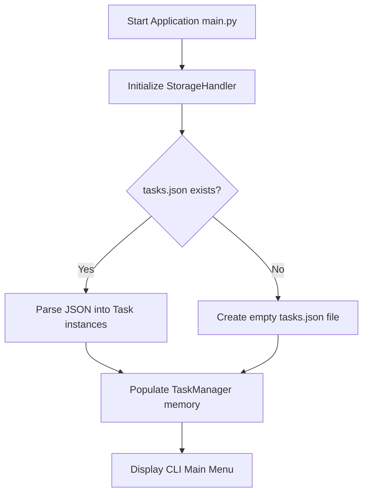
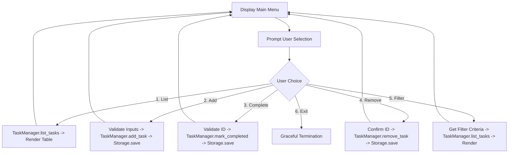

# Week 1 - Architecture & System Design Plan
## Simplified To-Do List Manager CLI Application

---

## 1. Executive Summary & Objective (Items 1 - 3)
The goal of this project is to design and develop a robust, maintainable, and user-friendly Command-Line Interface (CLI) **To-Do List Manager** in Python. 

### Core Design Values
- **Modular Design**: Clear separation of concerns between user interaction (CLI), business logic (Task Manager), data models, and storage persistence.
- **Object-Oriented Programming (OOP)**: Clean, domain-driven classes representing tasks and task management logic.
- **Fault-Tolerant & User-Friendly**: Graceful error handling, input validation, and intuitive prompts.
- **Zero External Dependencies**: Pure Python standard library implementation (`json`, `datetime`, `enum`, `dataclasses`, `os`, `sys`).

---

## 2. Deliverables Mapping (Items 4 - 5)
In accordance with deliverables 4 & 5:
- **Modular Source Code**: Cleanly partitioned `.py` files with comprehensive inline docstrings and PEP 8 conformity.
- **`README.md`**: Step-by-step instructions for running, testing, and understanding design choices.
- **Persistence Store**: Local JSON-based persistent storage (`tasks.json`) with auto-initialization.

---

## 3. High-Level System Architecture (Item 6)

The application follows a **Layered Architecture (Separation of Concerns)** pattern:

```
+-------------------------------------------------------------+
|                     Presentation Layer                      |
|             (cli.py / Console Interface & Menus)             |
+-------------------------------------------------------------+
                              |
                              v
+-------------------------------------------------------------+
|                     Business Logic Layer                    |
|             (manager.py / TaskManager Controller)           |
+-------------------------------------------------------------+
            |                                     |
            v                                     v
+-----------------------+             +-----------------------+
|      Domain Layer     |             |   Persistence Layer   |
|   (models.py / Task)  |             | (storage.py / Storage)|
+-----------------------+             +-----------------------+
                                                  |
                                                  v
                                      +-----------------------+
                                      |     File System       |
                                      |     (tasks.json)      |
                                      +-----------------------+
```

### Layer Responsibilities
1. **Presentation Layer (`cli.py`, `main.py`)**:
   - Renders formatted menus, tables, and colored terminal feedback.
   - Captures user input, validates input types (integer IDs, non-empty text, valid dates).
   - Translates user intentions into calls to the Business Logic layer.

2. **Business Logic Layer (`manager.py`)**:
   - Manages task collection in memory.
   - Executes core business operations: adding, removing, updating, viewing, searching, and toggling completion.
   - Coordinates with the Persistence Layer to ensure state changes are saved.

3. **Domain Layer (`models.py`)**:
   - Encapsulates task data entities (`Task`), statuses (`TaskStatus`), and priorities (`Priority`).
   - Handles serialization (`to_dict`) and deserialization (`from_dict`).

4. **Persistence Layer (`storage.py`)**:
   - Handles reading and writing data to local JSON storage.
   - Implements atomic writes and schema migration/validation to prevent file corruption.

---

## 4. Module & Class Breakdown (Item 7)

### Module 1: `models.py`
- **`TaskStatus(Enum)`**: `PENDING`, `IN_PROGRESS`, `COMPLETED`.
- **`TaskPriority(Enum)`**: `LOW`, `MEDIUM`, `HIGH`.
- **`Task(Data Model)`**:
  - Attributes:
    - `id: int`: Unique identifier.
    - `title: str`: Short task title (mandatory, trimmed).
    - `description: str`: Optional notes.
    - `priority: TaskPriority`: Low, Medium, or High.
    - `status: TaskStatus`: Current status.
    - `due_date: Optional[str]`: Due date (YYYY-MM-DD format).
    - `created_at: str`: ISO-8601 creation timestamp.
  - Methods:
    - `mark_completed()`: Updates status to `COMPLETED`.
    - `to_dict()`: Converts instance to JSON-serializable dictionary.
    - `from_dict(data: dict) -> Task`: Factory method to instantiate from dictionary.

### Module 2: `storage.py`
- **`StorageHandler`**:
  - Attributes: `filepath: str` (default `tasks.json`).
  - Methods:
    - `load_tasks() -> List[dict]`: Safely reads and parses JSON, returning empty list if file is absent or newly initialized.
    - `save_tasks(tasks_data: List[dict]) -> bool`: Writes formatted JSON to disk with exception handling.

### Module 3: `manager.py`
- **`TaskManager`**:
  - Attributes:
    - `tasks: Dict[int, Task]`: In-memory hash map of tasks indexed by ID for $O(1)$ lookups.
    - `storage: StorageHandler`: Persistence bridge.
  - Methods:
    - `add_task(title, description, priority, due_date) -> Task`
    - `remove_task(task_id: int) -> bool`
    - `get_task(task_id: int) -> Optional[Task]`
    - `list_tasks(status_filter=None, priority_filter=None) -> List[Task]`
    - `mark_completed(task_id: int) -> bool`
    - `update_task(task_id: int, **fields) -> bool`

### Module 4: `cli.py` & `main.py`
- **`CLIView`**:
  - Displays formatted banners, tables, and status messages.
  - Interactive loop handling options:
    1. View All Tasks
    2. Add New Task
    3. Mark Task as Completed
    4. Remove Task
    5. Search / Filter Tasks
    6. Exit Application
- **`main.py`**:
  - Entry point initializing storage, manager, and CLI view.

---

## 5. Application Logic & Control Flow (Item 8)

### Flow 1: Application Startup & Task Loading


### Flow 2: Task Action Execution Cycle


---

## 6. Error Handling & Validation Strategy
1. **Empty Titles**: Prevent blank tasks by validating `len(title.strip()) > 0`.
2. **Invalid IDs**: Check that IDs exist in `tasks` collection before mutating.
3. **Date Formats**: Validate due dates against `YYYY-MM-DD` using `datetime.strptime`.
4. **File Corruptions**: Catch `json.JSONDecodeError` during load; backup damaged file and start safe session without crashing.
5. **Keyboard Interrupt**: Intercept `Ctrl+C` (`KeyboardInterrupt`) to exit cleanly without raw stack traces.
